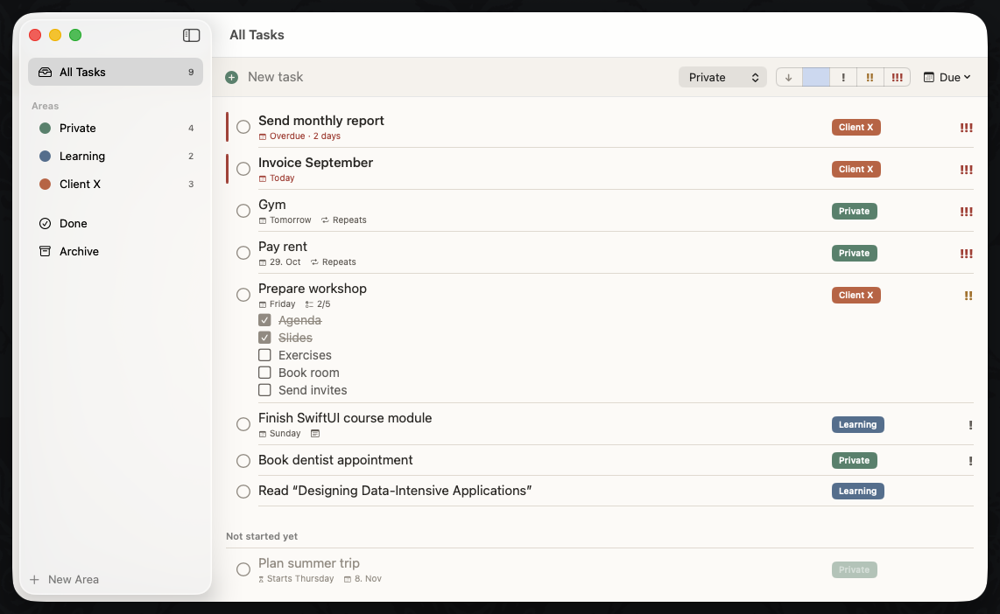
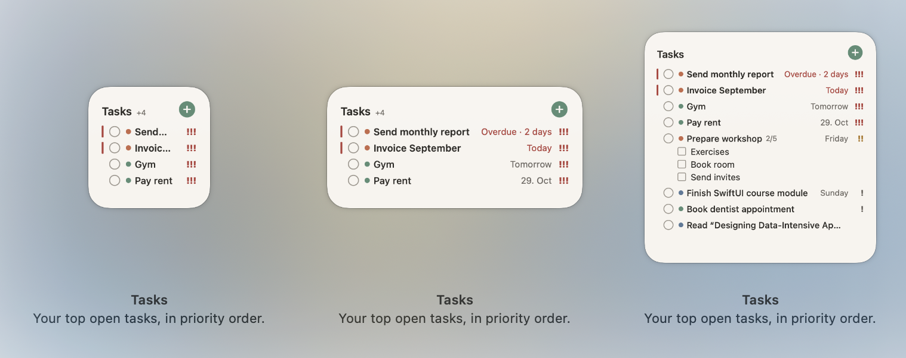

# Tasks

> *I never really got along with the built-in Reminders app. It didn't fit the way I actually work, so I made my own: a task app that sorts things the way I think about them. Urgent and overdue stuff comes first, priorities go up on their own as deadlines get closer, and the widget shows what to do next right on my desktop. It's built for exactly one person (me), but feel free to look around.*
>
> — Susanna

A personal task list app for macOS with an interactive desktop widget. Built with Swift and SwiftUI for macOS 14+. All data stays on this Mac in a local SQLite database.





## Features

- **Areas**: tasks are grouped into colored areas (e.g. Private, Learning, Client X), each with its own list, plus an "All tasks" list.
- **Priority**: five levels from Low to Urgent. A task's priority rises automatically as its due date gets close (effective priority).
- **Sorting**: overdue tasks first, then effective priority, due date, area order and title. Tasks with a future start date are greyed out at the bottom.
- **Recurring tasks**: weekly or monthly repeats with a required end date. Completing an occurrence creates the next one.
- **Subtasks**: a simple checklist inside each task, with progress shown on the row.
- **Done and Archive**: completed and archived items can be reopened or restored. They are permanently removed after 30 days.
- **Widget**: shows the top open tasks for all areas or a single area. Tasks can be completed from the widget, and an add button opens quick-add in the app.
- **Backup**: JSON export and import. Import merges by id and never deletes anything.

### Keyboard shortcuts

| Shortcut | Action |
|---|---|
| ⌘N | New task (quick add) |
| ⌘↩ | Complete selected tasks |
| ⌘3 / ⌘2 / ⌘1 / ⌘0 / ⌘- | Priority: Urgent / High / Raised / Normal / Low |
| ⌫ | Archive selected tasks |
| ⇧⌘E | Export backup |
| ⇧⌘I | Import backup |

## Project layout

```
Tasks/                  macOS app (SwiftUI views and AppModel)
TasksWidget/            WidgetKit extension and App Intents for the widget buttons
Shared/                 Code used by both app and widget: styling, colors, deep links
Packages/TasksKit/      Swift package
  TasksCore/            Pure Swift: models, repository protocol, business logic
                        (effective priority, ordering, recurrence, purge, backup)
  TasksStore/           SQLite implementation of the repository (GRDB)
Config/                 xcconfig, Info.plists and entitlements
scripts/                install-release.sh
design/                 Palette preview (palette-preview.html)
```

The UI only depends on the `TaskRepository` protocol in `TasksCore`, not on the storage engine. `TasksCore` uses nothing beyond Foundation, so its business logic can be ported to another platform later.

## Data and sync readiness

- The database lives in the shared App Group container, so the app and the widget read the same data:
  `~/Library/Group Containers/<TeamID>.fi.sannier.tasks/Library/Application Support/Tasks/tasks.sqlite`
- Every record has a UUID and `createdAt` / `updatedAt` timestamps.
- Start and due dates are stored as date-only `YYYY-MM-DD` values.
- Deletion is two-step: archive or complete first, then purge after 30 days. Purged ids are kept in a tombstone table for future sync.

## Setup

Requirements: macOS 14+, Xcode 16+ and an Apple ID. The free personal team is enough.

1. Find your team id in Xcode > Settings > Accounts > your Apple ID.
2. Create `Config/Local.xcconfig` (git-ignored) with:

   ```
   DEVELOPMENT_TEAM = ABCDE12345
   ```

3. Open `Tasks.xcodeproj` in Xcode, or build from the command line as shown below.

The App Group id is derived from the team id (`<TeamID>.fi.sannier.tasks`), so no group needs to be registered.

## Build and run

Debug build:

```sh
xcodebuild -project Tasks.xcodeproj -scheme Tasks -destination 'platform=macOS' \
  -derivedDataPath build/DerivedData -allowProvisioningUpdates build
```

The **Tasks (Demo)** scheme launches the app with `-demo`, which uses in-memory sample data instead of the real database. The widget keeps showing the real data.

### Install the Release build

```sh
scripts/install-release.sh
```

This builds a Release version, installs it as `/Applications/Tasks.app`, removes the Debug copy and restarts the widget service. Run it again after changes you want to see in the installed app and widget. A Debug copy left registered next to the installed one can make the desktop widget run old or broken code.

## Tests

The business logic and the SQLite store have unit tests in the Swift package:

```sh
swift test --package-path Packages/TasksKit
```

## Widget troubleshooting

- **Widget shows old code after a rebuild:** run `pkill -x TasksWidget`. WidgetKit relaunches it from the new build.
- **Widget is blank:** it may be an instance of an older widget kind. Remove it and add "Tasks" again from the widget gallery.
- **Logs:**

  ```sh
  /usr/bin/log show --last 10m --info --style compact \
    --predicate 'process == "chronod" OR process == "TasksWidget"'
  ```

- Don't rename the widget kind (`TasksWidget`). Placed widgets would stop working.
